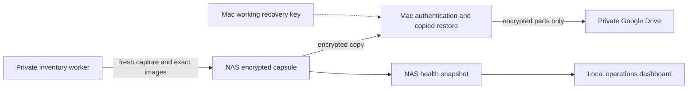

# Private-trial operating reliability

The operations view is separate from the inventory interface. It reports current
application checks, storage reserves, the NAS capture, the last verified Mac
recovery point and the last verified Google Drive copy. Historical dashboard
sections remain dated snapshots. The UI/UX overhaul is a separate project.

## What runs where

| Work | Location | Schedule / boundary |
| --- | --- | --- |
| API/web response, database health, expected images/ports, restart policy, storage and capture-task result | NAS user timer | Every five minutes; survives Mac/app unavailability |
| Fresh database/media capture, exact saved images and matching Git source; CMS encryption using the public recipient certificate | NAS user timer | 02:30 America/New_York; one completed capture per local date |
| Copy encrypted bytes, authenticate decryption, validate capsule/images/source, restore and compare every row/migration/media file | Approved Mac plus an isolated restore environment | Existing daily operator task; preserve the independent recovery key |
| Upload already encrypted parts, read back private permissions and every uploaded byte, rejoin/hash/authenticate | Existing connected Google Drive tools | After verified Mac recovery; remains a separate status |
| Owner failure notifications | Existing operator chat | Hourly checks while the Mac/app is available; unchanged healthy/known states stay quiet |

A NAS capture is not an off-site copy and is not called a verified copied
restore. These checkpoints may cover different captures; each verification time
and release stays visible. The 1Password recovery-key copy remains independent.
No routine task needs vault access, new credentials or another key-custody prompt.

## Status and failure behavior

- Expected services must run the pinned images with the existing private network
  boundary. Running containers alone are insufficient: check API/web responses
  and database health. Guest inventory access must remain blocked.
- The dashboard refuses stale or malformed snapshots. A failed read becomes
  Unverified; previous green states are not kept as current.
- Daily recovery points become Action needed after 36 hours. The daily target is
  one verified point per day, with grace for runtime/provider availability.
- Keep at least 5 GiB free on NAS, worker and Mac. Capture also budgets database,
  media and image staging above that reserve; Mac verification budgets actual
  archive size. Insufficient space stops work, never triggers deletion.
- Incident identity/state is recorded separately from changing free-space or age
  text. Unchanged failures do not generate repeated notifications. Missing checks
  cannot silently become recovered.
- The desktop notification path and connected Drive tools still need an available
  Mac/app. NAS capture/checks continue without them. An external always-on alert
  channel or NAS-owned Drive authorization is a separate credential decision.

The installed NAS user manager already had lingering enabled. User timers need
no new root service or account privilege. Templates live in `infra/systemd/`.
`unless-stopped` restart policy supports normal host/daemon recovery while
preserving deliberate stops; it does not promise recovery from every power-loss
or interrupted-capture scenario. Monitoring reports unresolved restart problems.

## Operator tools

All configuration is trusted operator input in private, ignored JSON files,
not a browser upload. Keep directories 0700 and files 0600; explicitly verify
permissions on filesystems with inherited ACLs. Never commit actual paths,
credentials, provider tokens or inventory contents.

- `scripts/operations.py collect --config PRIVATE --output PRIVATE`: bounded,
  read-only checks and incident snapshots. `serve` additionally requires
  `--report docs/project-dashboard.html` and binds only loopback. Only fixed
  report/status routes are served; Host checks, no-store and restrictive CSP
  protect the local surface. Private configuration is never an HTTP resource.
- `scripts/operations.py sync-evidence --config PRIVATE --output PRIVATE`:
  synchronize only selected verification fields, never archives, credentials,
  paths or collection contents. A failed cloud copy must not replace an earlier
  valid cloud receipt or invalidate a verified Mac point.
- `scripts/nas-capture.py capture --config PRIVATE`: NAS coordinator. It holds a
  local lock, verifies the public certificate identity, checks deployment pins,
  invokes the recorded worker helper and streams into authenticated encryption.
  Duplicate-day retries verify exact existing bytes and do not recapture.
- The same helper's `worker` mode calls the deployed release's `backup.py create`.
  It checks source/Compose/owner-file fingerprints, images, service ownership,
  no published app ports, stopped Symphony, capacity and restart identity.
  It excludes owner/provider/SSH settings and private decryption keys.
- `scripts/recovery-capsule.py`: requires authenticated CMS AES-256-GCM, successful
  authentication before extraction, fixed members, safe paths/types, all hashes,
  expected source and OCI/config identities. Verification failure remains private.
- `scripts/rehearse-recovery.py`: disposable VM only. Rejects live/existing/online
  engines, proves missing images fail, restores exact saved images/data, and can
  test a private app with fresh temporary owner configuration. **Successful
  rehearsal deletes its own restored volumes. Do not use it for a real restore
  you intend to retain.** Follow [replacement recovery](replacement-recovery.md).

The operator's private runbook records actual configuration, commands, receipts,
rollback and source hashes. Generic configuration shapes are described in the
scripts; the private installation is deliberately pinned rather than an automatic
production installer. Deployment changes must update those pins after reviewed
source/image/configuration verification. Never guess a new project or silently
fall back to mutable image tags. Preserve older configurations for inspection.

## Retention and maintenance

Retain all existing encrypted Mac/NAS/Drive archives, keys and retained manual
restores. There is no automatic archive deletion, mirroring or Docker prune.
Only a successful run's explicitly owned verification resources and plaintext
staging may be removed after copied-restore proof. Keep failures private/offline.

Review capacity monthly and after a substantial import: compare free space with
capture size and pending verification staging, and maintain the reserve above.
If the Mac stays unavailable, worker staging accumulates; capture must stop before
using its reserve. This is a deliberate safe limit, not a complete unattended
retention system. Any later deletion/rotation policy requires an explicit choice.

## Verification scope

A fresh Ubuntu guest was provisioned from the official checksum-verified
[Ubuntu cloud image](https://cloud-images.ubuntu.com/noble/current/), with a new
OS disk, kernel boot and empty Docker stores. After provisioning its external
default routes were removed. The current release's new NAS capture was copied
to the Mac and authenticated, then restored inside the isolated guest with
exact row/migration/media comparison. The isolated recovered app accepted fresh temporary owner credentials
and blocked guests. No live volumes or captured owner settings were used as its
runtime configuration, and no app port was published. The temporary VM/disk/key
and successful plaintext staging were removed; encrypted originals remain.

This proves replacement-VM recovery on the same NAS hardware. It does not prove
replacement physical hardware, a NAS-destroying event, or independent always-on
Drive/notification credentials. The first genuinely scheduled NAS-to-Mac-to-Drive
handoff remains a distinct milestone from manual setup validation. Local desktop
scheduling requirements are documented by [OpenAI](https://learn.chatgpt.com/docs/automations?surface=app).
